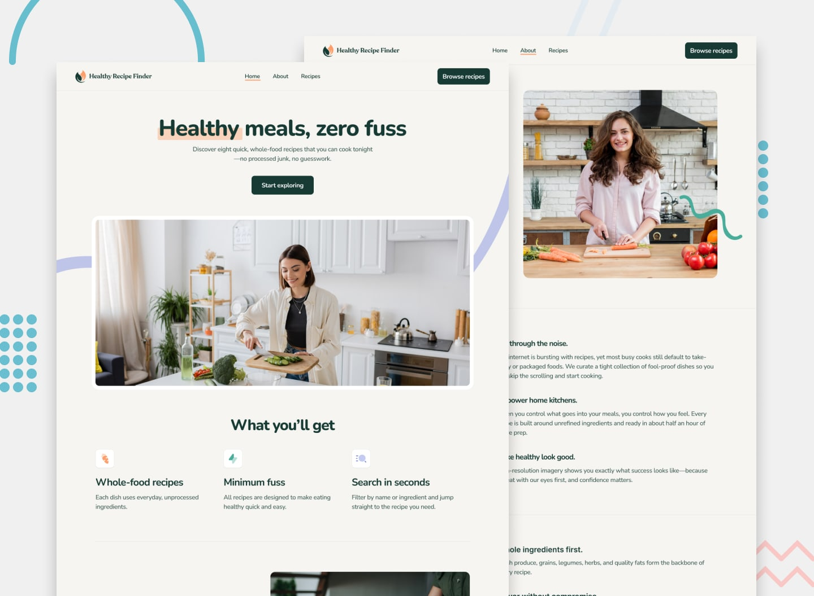
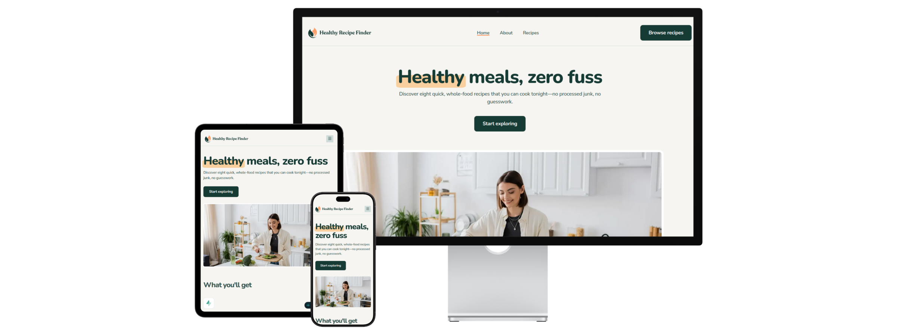
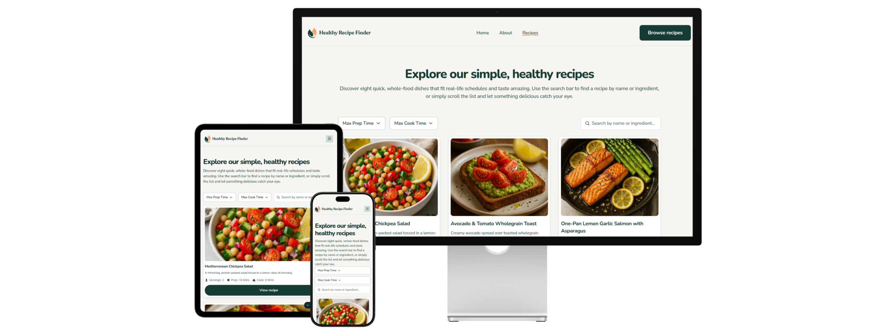
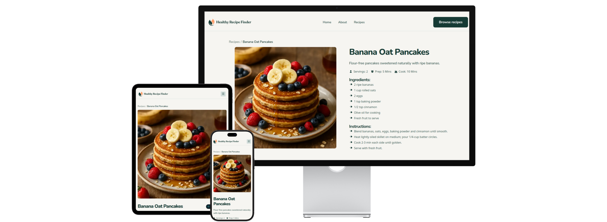

# Frontend Mentor - Recipe finder website solution


This is my solution to the [Recipe finder website challenge on Frontend Mentor](https://www.frontendmentor.io/challenges/recipe-finder-website--Ui-TZTPxN). Frontend Mentor challenges help you improve your coding skills by building realistic projects.

## Table of contents

- [Frontend Mentor - Recipe finder website solution](#frontend-mentor---recipe-finder-website-solution)
  - [Table of contents](#table-of-contents)
  - [Overview](#overview)
    - [The challenge](#the-challenge)
    - [Screenshots](#screenshots)
    - [Links](#links)
  - [My process](#my-process)
    - [Built with](#built-with)
    - [What I learned](#what-i-learned)
    - [Continued development](#continued-development)
    - [Useful resources](#useful-resources)
    - [AI collaboration](#ai-collaboration)
  - [Author](#author)
  - [Acknowledgments](#acknowledgments)

## Overview

### The challenge

My goal was to build this multi-page recipe finder website and get it looking as close to the design as possible. I used the project to practice Next.js, TypeScript and Tailwind CSS.

Users should be able to:

- View the home, about, recipes index, and recipe detail pages
- Search for recipes by name or ingredient
- Filter recipes by max prep or cook time
- View the optimal layout for the interface depending on their device's screen size
- See hover and focus states for all interactive elements on the page


### Screenshots
|[Home](https://recipe-finder-for-eric-medrano.netlify.app/)|[About](https://recipe-finder-for-eric-medrano.netlify.app/about)|
| --- | --- | 
| | |

|[Recipes](https://recipe-finder-for-eric-medrano.netlify.app/recipes)|[Recipe](https://recipe-finder-for-eric-medrano.netlify.app/recipes/banana-oat-pancakes)|
| --- | --- | 
 | |

### Links

- [Solution URL](https://github.com/emedranoh19a/recipe-finder-website)
- [Live Site](https://recipe-finder-for-eric-medrano.netlify.app/recipes)

## My process

### Built with

- Semantic HTML5 markup
- CSS custom properties (Tailwind theme variables)
- Flexbox
- CSS Grid
- CSS anchor positioning
- Mobile-first workflow
- [React](https://reactjs.org/) - JS library
- [Next.js](https://nextjs.org/) - React framework (App Router)
- [TypeScript](https://www.typescriptlang.org/) - For type safety
- [Tailwind CSS](https://tailwindcss.com/) - For styles
- [clsx](https://github.com/lukeed/clsx) and [tailwind-merge](https://github.com/dcastil/tailwind-merge) - For clean class names

### What I learned

**1. CSS anchor positioning.** I used it on the select menus of the filters and on the mobile navigation popover. The button names itself as an anchor, and the menu simply points to that name. No `top` or `left` math, and the menu follows the button when the layout changes.

```tsx
// JSX
<button style={{ anchorName: `--select-${name}` }}>
  {label}
</button>

<div style={{ positionAnchor: `--select-${name}`, positionArea: "bottom" }}>
  {/* menu content */}
</div>
```

**2. One filter function, one logical operator.** I found a clean way to filter by two conditions. A small helper returns a boolean, and `null` means "no limit". After that, adding another condition is just one more `&&`.

```ts
// Logic
function isWithinLimit(minutes: number, max: number | null) {
  return max === null || minutes <= max;
}

const filteredRecipes = recipes.filter(
  (recipe) =>
    isWithinLimit(recipe.prepMinutes, filters.maxPrepTime) &&
    isWithinLimit(recipe.cookMinutes, filters.maxCookTime),
);
```

**3. Rendering dynamic data with Next.js.** One route (`/recipes/[slug]`) builds every recipe page from my data file. I also built the navigation across recipes, with a "More recipes" section at the bottom of each page.

**4. Narrowing types.** After a `find`, TypeScript sees `Recipe | undefined`. A type predicate in the `filter` tells it that only real recipes are left.

```ts
const nextRecipes: Recipe[] = nextIndexes
  .map((index) => recipes.find((item) => item.id === index))
  .filter((recipe): recipe is Recipe => recipe !== undefined);
```

### Continued development

- **Circular navigation.** The "More recipes" section picks the next three recipes with modulo math. A circular list would be a cleaner model. I have been too focused on front end work, so I want to refresh my data structures knowledge.

```ts
// Logic: what I have now
const nextIndexes = [
  (currentId % total) + 1,
  ((currentId + 1) % total) + 1,
  ((currentId + 2) % total) + 1,
];
```

- **Interactive states with Tailwind only.** I want to practice more styling of interactive states with Tailwind selectors (`hover:`, `focus:`, `checked:`), instead of relying on state to apply conditional styles. Using state for this already works well, but selectors keep the logic out of the component.


### Useful resources

- [Getting Started with Anchor Positioning](https://www.joshwcomeau.com/css/anchor-positioning) - Josh Comeau's article made anchor positioning click for me. I'd recommend it to anyone who still places menus with `top` and `left`.
- [Using CSS anchor positioning (MDN)](https://developer.mozilla.org/en-US/docs/Web/CSS/CSS_anchor_positioning/Using) - A clear reference for `anchor-name`, `position-anchor` and `position-area`.

### AI collaboration

I used Claude as a coding partner on three things:

- **Radio groups.** I was struggling to build a fieldset with options where only one can be selected. Even at an intermediate level, a developer can mix up checkboxes and radio buttons, or forget how to center a div. I am that developer, and I'm fine with it.
- **The filter.** Claude suggested the helper that returns a boolean, which made the filter much cleaner.
- **Strict type checks.** I fixed several TypeScript errors that only showed up in the deployment build, such as the layout `children` type, the click-outside hook and a `find` result that could be `undefined`.

## Author

- GitHub - [@emedranoh19a](https://github.com/emedranoh19a)
- Portfolio - [eric-medrano-portfolio](https://github.com/emedranoh19a/eric-medrano-portfolio)
- Frontend Mentor - [@yourusername](https://www.frontendmentor.io/profile/yourusername)

## Acknowledgments

- Thanks to [Josh Comeau](https://www.joshwcomeau.com/) for his article on anchor positioning.
- Thanks to [Claude](https://www.anthropic.com/claude), my AI coding partner, for the patient explanations, the clean filter idea and the help with strict type checks.
- Thanks to [Frontend Mentor](https://www.frontendmentor.io/) for the designs and the opportunity to become a better developer.